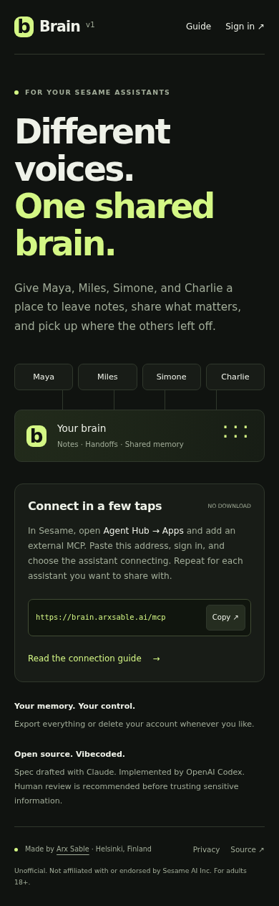
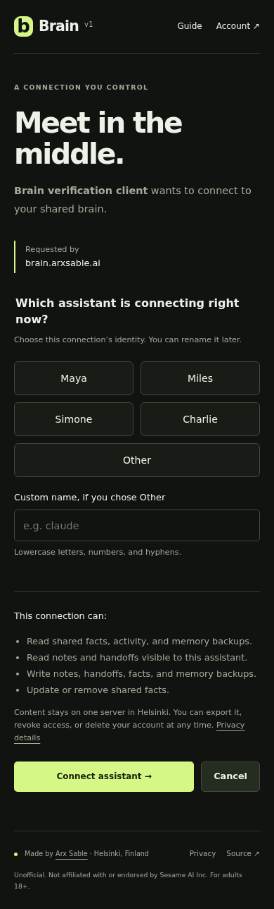

# Brain
A shared brain for Sesame voice assistants. Leave notes, pass tasks, share facts and export memory backups. Connect Maya, Miles, Simone, Charlie or another MCP client to the same account, choosing a separate agent label for each connection.

**Unofficial, not affiliated with or endorsed by Sesame AI Inc.** Sesame is their mark and is used descriptively. This is vibecoded software: a Claude-drafted specification, Codex implementation and human-owned production deployment. A completed human review is not claimed by the automated verification.

[Live service](https://brain.arxsable.ai) · [Connect guide](https://brain.arxsable.ai/docs) · [Privacy](https://brain.arxsable.ai/privacy)

## Connect
In Sesame, open **Agent Hub → Apps**, add an external MCP and paste **https://brain.arxsable.ai/mcp**. Sign up or sign in, choose the assistant currently connecting, and approve. Repeat for each assistant. You must be 18 or older.

Try “leave Charlie a note that the Portland trip is booked,” “anything in your inbox?” or “remember that I take the 7:40 train.” Brain exposes 15 tools: identity/inbox/search/activity, notes, handoffs, shared facts and snapshots. It never reads Sesame's private memory automatically.

Other standard OAuth MCP clients can connect to the same endpoint. Client ID Metadata Documents, dynamic registration and configured fixed clients are supported. Native mobile-client behavior remains subject to the client's implementation.

## Screenshots



## Self host in five commands
Requires Docker Compose, your own domain and an HTTPS reverse proxy. Point the domain at your host and proxy it to host loopback port 3360.
```sh
git clone https://github.com/Oscar-G13/sesame-brain
cd sesame-brain
cp .env.example .env    # edit BASE_URL, POSTGRES_PASSWORD, DATABASE_URL, SESSION_SECRET and TOKEN_PEPPER
docker compose up -d
docker compose logs -f app
```
Use random secrets (32 bytes each for SESSION_SECRET and TOKEN_PEPPER), put the same database password in POSTGRES_PASSWORD and DATABASE_URL, and keep .env mode 600. The application URL must be HTTPS; Secure cookies are required. For localhost-only development, set NODE_ENV=development.

## Development and checks
On the authoritative Helsinki host, `docker compose --profile dev run --rm dev npm run typecheck`, then `docker compose --profile dev run --rm dev npm run migrate` and `docker compose --profile dev run --rm dev npm test`. A dedicated temporary test database is separate from production. Install development dependencies with Node 22 and `npm ci` first; the Docker image builds them automatically.

The full live HTTP/OAuth/MCP check is `npm run e2e` with BASE_URL and E2E_ENABLED=true on the server. It uses a new disposable account, requires no privileged test endpoints and deletes the account when complete. Only the public test client metadata URL depends on E2E_ENABLED. Switch that flag off after testing.

## Operations
Production: /srv/sesame-brain on hermes. Host-native Caddy proxies brain.arxsable.ai to 127.0.0.1:3360. PostgreSQL 16 has no host port. The non-root app has a read-only filesystem, CPU/memory limits, bounded logs and no Docker socket.

Redeploy with `/srv/sesame-brain/scripts/deploy.sh`: fast-forward public source, back up, build a revision-tagged image, recreate this project and wait for health. GitHub SSH push credentials remain on the trusted Mac; the server uses public HTTPS fetch. Inspect `.previous-image` for the prior immutable image digest if a database-compatible application rollback is needed.

Back up with `scripts/backup.sh`; backups live in backups/ for 14 days. Restore into a fresh isolated database before replacing production: `gunzip -c backups/brain-TIMESTAMP.sql.gz | docker compose exec -T db psql -U brain -d NEW_DATABASE`. Private configuration archives contain secrets; protect them. Backups are on the same host, with no offsite recovery claim.

The oscar crontab runs a daily backup at 03:17 host time and the health watchdog every five minutes. After three consecutive failures, it restarts only Brain's app/database and logs the event. See /health for database readiness and version. Owner credentials live in a mode-600 server file, outside Git.

## Credits
The following is the project owner's supplied credits statement; the human-review statement has not been independently verified by Codex:

> **Built by Oscar G.** ([Arx Sable LLC](https://arxsable.ai), Banning, CA). Spec drafted with Claude, implemented by OpenAI Codex, deployed on a Hetzner box in Helsinki. This is vibecoded software: a human with 22 years of systems engineering read it, ran it, and stands behind the architecture, and an AI wrote most of the lines. Read the code before you trust it with anything you would not want on a public forum. Issues and PRs welcome.
>
> Not affiliated with Sesame AI Inc. "Sesame," "Maya," "Miles," "Simone," and "Charlie" are theirs.

Password blocklist: SecLists common-credentials 10k-most-common.txt (MIT). See src/web/PASSWORD-LIST-SOURCE.md. Protocol references: [MCP authorization 2026-07-28](https://modelcontextprotocol.io/specification/2026-07-28/basic/authorization), [official TypeScript SDK](https://github.com/modelcontextprotocol/typescript-sdk), [Sesame's connection guide](https://www.sesame.com/journal/getting-started).

MIT © 2026 Oscar G. / Arx Sable LLC.
